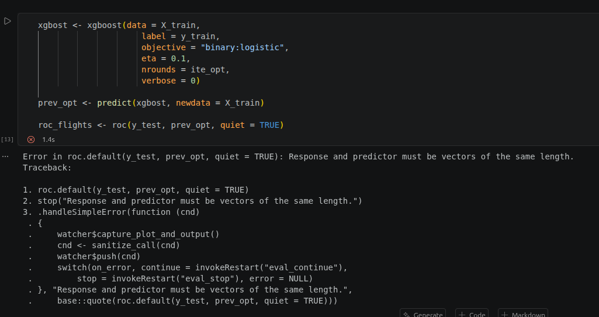

# Quizz Wooclap — XGBoost

## Quizz joué en conclusion de la présentation. 5 questions à choix (simple ou multiple). Les bonnes réponses sont en **gras**.

---

## Q1, (choix unique)

Un modèle boosting s'écrit comme une somme :
`Ensemble Boosting = premier arbre + n × deuxième arbre`, soit `F(m) = F(m-1) + n × (− dL / dF(m-1))`.
L'objectif est `Loss(ensemble boosting) < Loss(premier arbre)`. Que représente le symbole **n** dans cette formule ?

- Le nombre total d'arbres
- La profondeur maximale d'arbre
- **Le taux d'apprentissage** 
- Le nombre de graines
- L'erreur du premier arbre

*Explication : `n` règle le poids de chaque nouvel arbre ajouté. Plus il est petit, plus l'apprentissage est lent mais stable.*

---

## Q2, (choix unique)

Le premier modèle affiche une AUC qui passe de environ 0,91 (1 arbre) à environ 0,96 (100 arbres). Que peut-on conclure ?

- Le modèle généralise très bien, il est prêt à être utilisé
- Il se peut qu'il y ait un nid d'oiseau dans l'arbre
- L'ordi a pris l'eau, ce qui a provoqué une croissance luxuriante de l'arbre
- **Rien sur la généralisation** 

*Explication : cette AUC est mesurée sur les données d'apprentissage, elle monte forcément avec le nombre d'arbres et peut masquer du surapprentissage. Seule une validation croisée ou un jeu de test dit quelque chose sur la généralisation.*

---

## Q3, (choix unique)

On écrit ce code pour évaluer son modèle. Quel est le problème ?

- C'est xgboost, et non xgbost !!
- **On évalue le modèle sur X_train** 
- ON A OUBLIÉ DE CONVERTIR y_test EN MATRICE
- cliquez ici pour demander Gemini.

*Explication : le code tourne sans erreur, mais il prédit et évalue sur les données d'entraînement. L'AUC est trop optimiste. Pour une vraie évaluation, on prédit sur `X_test` (et on compare à `y_test`).*

---

## Q4, (choix multiple — plusieurs faux)

Dans le notebook, `xgb.cv` est lancé avec `nrounds = 300` et `early_stopping_rounds = 10`. La sortie donne `best_iteration = 232` et `niter = 242`. Lesquelles de ces affirmations sont fausses ?

- easy-peasy, niter : 232 + 10 = 242 
- L'AUC de validation était maximale vers 232 arbres, au-delà elle ne s'améliorait plus, donc on retient ce nombre 
- **si on définit nrounds = 9999…9, la fonction xgb.cv continuera à s'exécuter jusqu'à la fin du monde**  (faux)
- **Je dois faire 300 tours autour de l'arbre**  (faux)

*Explication : les deux premières sont vraies (`niter = best_iteration + early_stopping_rounds`, et on retient le meilleur tour). Fausses : même avec `nrounds` énorme, l'arrêt anticipé stoppe dès que la validation ne progresse plus et la dernière est une blague.*

---

## Q5, (choix multiple)

Lesquels de ces points sont des avantages de XGBoost ?

- **La régularisation explicite : L1 et L2** 
- **La parallélisation : utilisation du multicoeur pour l'entraînement** 
- **La validation croisée intégrée : sans packages externes** 
- Une meilleure performance que le gradient boosting classique : XGBoost est plus performant

*Explication : régularisation, parallélisation et validation croisée intégrée sont bien des atouts de XGBoost. En revanche, rien ne garantit une meilleure performance, sur ce TP, son AUC est quasi identique à celle de gbm, il est surtout plus rapide et plus flexible, pas automatiquement plus précis.*

---

